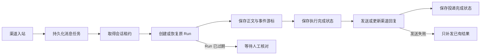

# 渠道消息可靠性与恢复

## 行为与边界

| 场景 | 行为 |
|---|---|
| 同一绑定重复收到消息 | 复用原任务与 Run，同一会话通过数据库租约串行执行 |
| 不同绑定的消息 ID 相同 | 独立去重和执行 |
| Agent 完成，但发送失败 | 已保存结果，补发不会重新执行 Agent 或工具 |
| SSE 断开 | 携带 Last-Event-ID 续接原 Run；没有终止事件不能标为成功 |
| 进程重启 | 后台扫描持久化任务，租约到期后继续处理 |
| 原 Run 已过期或丢失 | 标为需要核对，阻止隐式重跑；同一会话的后续执行等待核对结束 |
| 外部发送结果不确定且无法安全重试 | 标为需要核对，禁止无依据补发 |
| 飞书或微信连接退出 | 更新真实连接状态并退避重连，停止时释放连接资源 |
| 钉钉消息发送 | 当前尚未接入真实发送；显式失败并保留执行结果，不伪造发送成功 |

飞书连接使用每绑定独立子进程，隔离 SDK 的模块级事件循环。父进程持久化入站消息后，才允许子进程回调完成；关闭时终止并回收子进程和队列。微信先持久化一批入站消息，再保存轮询游标，避免游标前进后消息丢失。

消息任务保存回复所需的原始上下文，可能包含平台回复令牌；绑定凭据仍由绑定表提供。任务查询接口不返回正文、原始上下文或凭据。请按业务数据保护渠道数据库。

远端平台幂等能力及有效期决定最终投递边界，不能宣称外部发送绝对恰好一次。飞书使用固定 UUID，微信使用固定 client_id；已有飞书回复通过消息 ID 更新。手动核对不能撤销已产生的工具副作用。

## 管理界面

进入飞书或微信渠道管理页，查看“消息处理状态”：

- **重试投递**：仅对已完成或已中断且可以安全补发的结果开放，不创建新 Run。
- **结束异常任务**：先核对工具执行及消息投递结果，再点击“已核对，确认结束”。记录核对者和时间，解除异常任务对会话后续消息的阻塞。
- 普通用户只可查看和操作自己参与的任务；管理员可以使用“全部绑定”范围。

接口为 `GET /api/channels/jobs?scope=my|all` 与 `POST /api/channels/jobs/{job_id}/actions`，操作类型为 `retry_delivery` 或 `close`。

## 配置

| 配置 | 默认值 | 含义 |
|---|---:|---|
| CHANNEL_AGENT_CONNECT_TIMEOUT_SECONDS | 10 | Agent HTTP 连接超时，秒 |
| CHANNEL_AGENT_READ_TIMEOUT_SECONDS | 90 | SSE 无数据读取超时，秒 |
| CHANNEL_AGENT_STREAM_RETRIES | 3 | 一次消费过程中续接原 Run 的次数 |

恢复扫描间隔为 5 秒，每实例最多同时处理 8 个不同会话；任务与绑定租约有效期为 60 秒，每 20 秒续租。进度约每 0.5 秒批量保存，终止事件立即保存；不会按每个 token 写库。

## 启用与回退

| 项目 | 说明 |
|---|---|
| 数据变更 | 新增 channel_jobs 与 channel_leases 两张表，沿用渠道元数据数据库；不修改原有绑定和会话表结构 |
| 首次启用 | 先停止旧渠道实例，备份渠道元数据，启动一个新实例初始化表，再启动其他新实例；禁止旧新消费者混跑 |
| 多实例前提 | 元数据、Run、Thread 和检查点使用所有实例共享的持久化数据库；各实例系统时钟保持同步 |
| Run 保留期 | 应覆盖预期故障恢复窗口；超过保留期的运行需要人工核对，系统不会猜测并重跑 |
| 存量消息 | 旧表已完成消息保持保守去重；缺少绑定或 Run 信息的历史异常记录需要核对，禁止据此自动重跑工具 |
| 回退 | 先停止所有新渠道消费者并核对未完成任务，再回退代码；保留新增表与数据以便恢复。旧版没有新的任务去重和补发语义，不能直接混跑 |

代码安装与验证不等于已迁移或重启当前服务。实际启用前应确认备份、影响范围和回退步骤。
