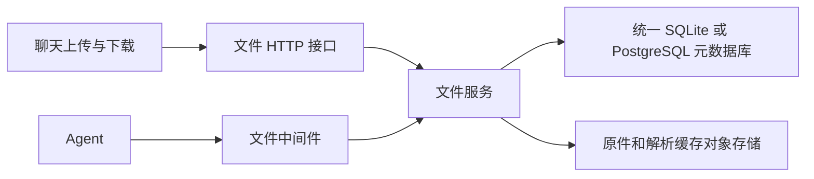

# 文件中间件

## 知识库入口

左侧统一使用「知识库」入口，默认打开用于向量索引、切片管理和 RAG 问答的知识库页面。页面顶部可在「知识库」和「文件知识库」之间切换。文件知识库是当前账号的一份文件列表，手动上传、聊天附件与模型生成件共用文件 ID、存储与权限。列表通过 `GET /api/files` 分页，选中文件后通过 `GET /api/files/{file_id}/preview` 按行预览。Excel 可切换 Sheet，PDF 显示原页码。下载始终返回原件。手机端将预览放在列表下方。

「全部」显示尚未收藏的文件。「收藏」显示已收藏的文件。收藏和取消收藏即时移动列表归属，文件 ID 和聊天链接继续有效。取消收藏后按移回时间重新计算保留期。

具备「写入聊天文件」权限的用户可以在两区的文件预览中确认删除本人文件。删除通过 `DELETE /api/files/{file_id}` 执行，文件随即从列表隐藏，历史聊天链接失效。原件与解析缓存由对象存储清理，失败后由后台重试。

Markdown 文件默认显示渲染后的正文，预览区可切换到「源格式」查看完整原文。两个视图复用同一次鉴权原件请求，按整份文档解析标题、表格及跨多行的代码块，渲染后的 HTML 在插入页面前进行清理。

每个账号可启用自动清理并填写 1 到 3650 天的保留期，默认关闭。服务后台每小时清理一次到期的未收藏文件，移除原件、解析缓存和数据库记录。任务与交互式 Agent 并行执行。对象删除失败时保留待清理记录，下一轮重试。角色管理的「读取聊天文件」允许查看两区和清理配置，「写入聊天文件」允许收藏、取消收藏和保存清理设置。

聊天上传和产物下载由 FastAPI 传输。通用 Agent 和 RAG Agent 挂载同一个文件中间件。HTTP 与工具共用文件服务、存储和权限规则。

聊天附件与文件知识库按账号、文件后缀、大小和 SHA-256 识别重复上传，复用已有文件 ID、名称和收藏状态。浏览器支持 Web Crypto 时通过 `POST /api/files/upload-check` 预检，命中后直接引用已有文件。上传请求仍由服务端计算摘要，数据库唯一索引防止并发创建重复记录。历史文件在首次重复提交原件时按需比对并补登记摘要。

RAG 知识库的预检入口为 `POST /api/rag/knowledge-bases/documents/upload-check`，去重范围为当前账号下的目标知识库。命中后复用已有文档对应的上传任务，失败任务可从上传列表重试。历史任务在重复提交时补登记摘要。游客上传仍走完整流程。

发送后的聊天附件在用户正文上方以文件卡片展示，列出文件名和格式，点击走原件下载接口。前端从消息末尾的附件区块恢复卡片，历史会话和刚发送的消息使用同一种展示方式，智能体仍可从消息取得文件 ID。

数据库保存稳定的文件 ID、所属账号、原始名称、格式、大小和创建时间。对象键由服务端生成。上传和生成创建独立文件，保留原件。登录用户通过角色管理的文件读取和文件写入权限获得对应能力，文件服务进一步按账号限制访问。未来通过文件 ID 增加共享授权记录，接收者使用相同的文件 ID，授权可撤销。

| 工具 | 契约 |
| --- | --- |
| `list_files` | 分页列出当前账号的文件，支持按文件名关键词、格式和收藏状态筛选。 |
| `inspect_file` | 返回文档行数、PDF 页数与无文字页，或列出 Excel 的 Sheet。指定 `sheet` 可预览最多三行，保留原始行号和列标。 |
| `read_file` | `start_line` 从 1 开始，`limit` 默认 100，最多 200。返回行号、内容、后续起始行和结束标记。Excel 可指定 Sheet 和列范围。首次读取 PDF 时自动把最多两页无法提取文字的页面转为图片，也可通过 `pages` 查看指定页。图片只进入当次模型输入。 |
| `grep_file` | 支持字面文本、完整匹配和正则。Excel 可指定搜索列，并在命中时返回同一行的指定列、行号和单元格坐标。指定列精确匹配可一次扫描至首批命中或表尾。 |
| `write_file` | 用 Markdown 正文生成 MD 或 DOCX，或用多个有序 Sheet 的结构化数据生成 XLSX。 |
| `export_file` | 把 Markdown 导出为新 DOCX，支持基础标题、段落、列表和表格。 |

TXT 和 Markdown 的行号来自文本。DOCX 的行号来自按正文顺序提取的段落和表格文本。PDF 用 PyMuPDF 提取文本层，按全文件连续编号并返回原始页码。无文字页用页码标记，扫描页可在后续接入多模态读取。Excel 的每张 Sheet 各自从第 1 行编号，保留空行和原始列坐标。缓存以文件 ID 和解析版本为键，读取与搜索引用同一份编号。

例如可用 `grep_file(file_id, pattern="X123", exact=True, sheet="明细", match_column="A", return_columns=["B", "C"])` 按订单号查金额和状态。需要查看相邻行时，可用 `read_file` 指定起始行号。新文件在保存时生成轻量结构摘要，历史文件缺少摘要时从已有解析缓存读取。生成的文件可从聊天回复下载，下载再次校验账号与权限。

`search_complete=false` 时，请用相同查询条件和 `next_cursor` 继续搜索，即使当前页的 `matches` 为空。Excel 行超出输出预算时，`read_file` 和 `grep_file` 优先保留短字段，并在 `truncated_columns` 中标明内容被截短或省略的列。可单独读取这些列以获取更多内容。

聊天输入框的「+」可以添加图片或文档。每条消息最多添加 4 个文档，单个文档最多 20 MiB。服务端使用 `POST /api/files` 接收原件，通过 `GET /api/files/{file_id}/download` 提供鉴权下载。上传成功后即保存至当前账号，从输入框移除仅取消本轮引用。DOCX、TXT、MD、PDF 和 XLSX 都可上传。

以 DeepAgent 模式构建时，聊天文件工具使用 `read_chat_file` 和 `write_chat_file`，工作区保留 DeepAgent 自带的文件工具。聊天文件的权限分别为 `files.view` 和 `files.manage`。导出 Word 同时需要读写权限。
