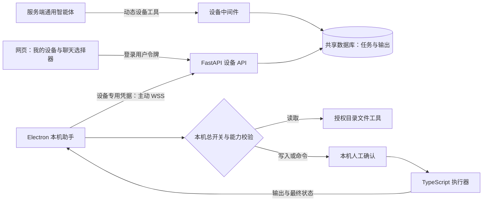
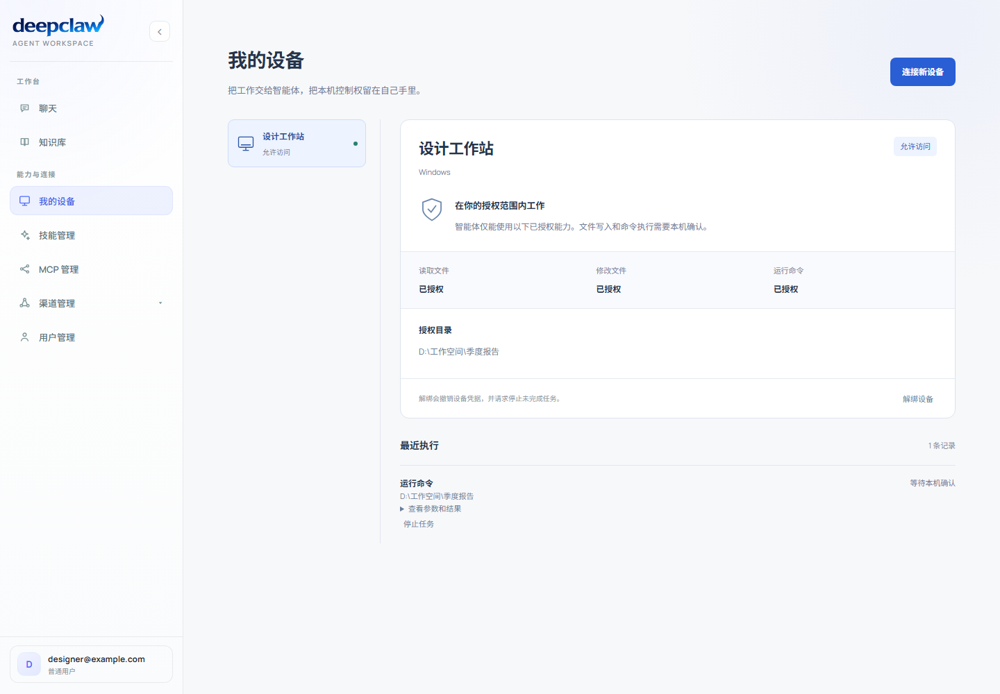
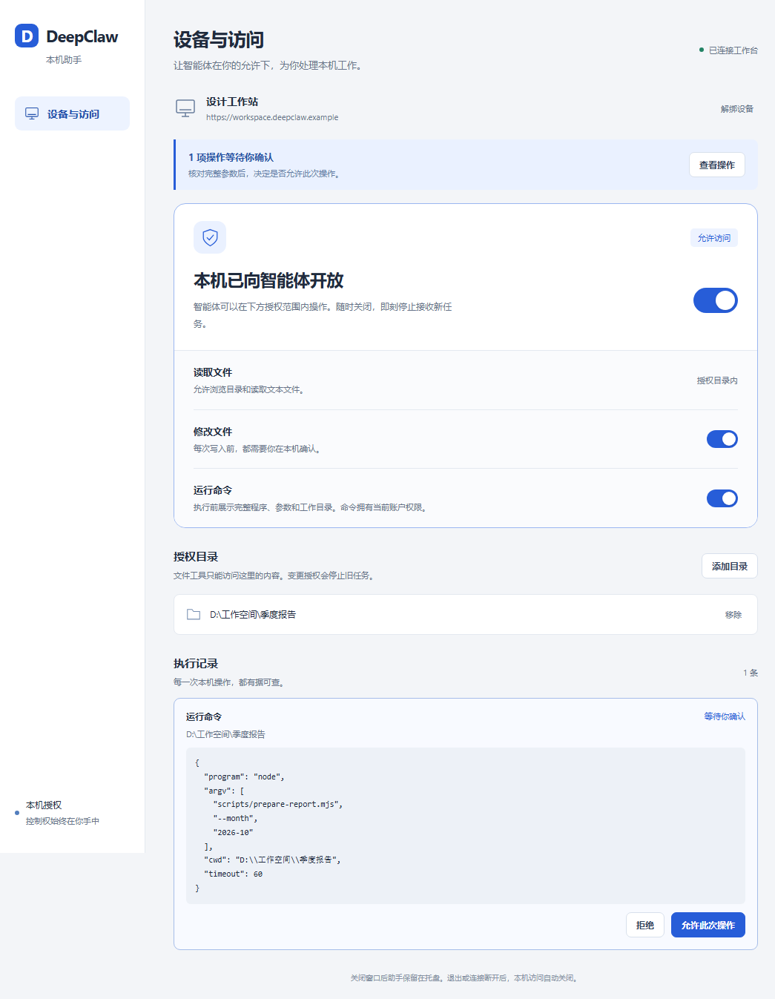
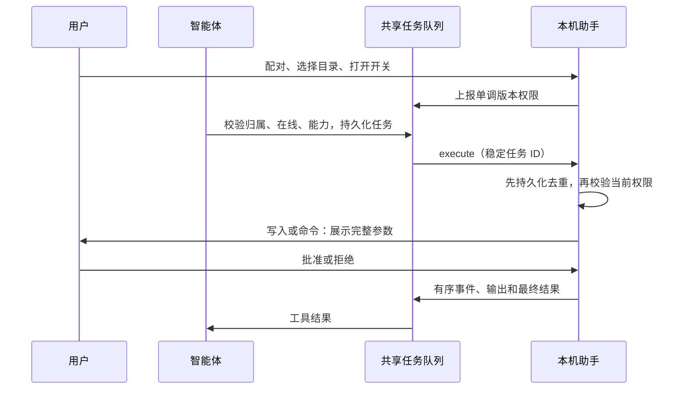

# 客户端设备执行

## 结构与权限



桌面端全部使用 TypeScript，复用现有 Python 服务端。网页不能打开本机授权；配对、客户端启动与重连均默认关闭。服务端从登录身份覆盖 `state.user_id`，设备归属按用户隔离，管理员也不能操作他人的设备。

网页聊天显式发送 `state.device_id`：空值禁用本轮设备工具，非空只允许该设备。IM 未传该字段时可使用当前用户已开启的设备。模型调用时才注入在线、开启设备的名称、目录与能力；关闭后不再注入新信息，但已经进入聊天历史的内容不会被追溯删除。

## 一次操作的生命周期

网页设备管理与本机授权台（界面验证使用示例数据）：







服务端用用户、设备、会话、工具调用 ID 派生稳定任务 ID；本机 SQLite 在执行前登记任务。重复投递不重新执行，事件用序号确认重传。客户端重启前仍运行的任务标记为 `uncertain`，等待人工核对，禁止自动重跑。取消先于执行消息到达时也登记取消记录。

文件读取在授权目录内自动执行；文件写入和每条命令需要本机确认。改变目录、能力或总开关会取消旧版本任务。取消运行中进程后，等待进程退出才报告取消；取消不能撤销已经发生的文件或外部系统修改。

文件工具校验真实路径，拒绝路径穿越和指向目录外的链接。目录校验不是抵御本机恶意进程并发替换路径的操作系统隔离机制。命令采用 `spawn(program, argv, shell:false)`，限制工作目录、超时和输出，但进程拥有当前账户权限，不能宣称命令只能访问授权目录；需要更强隔离时应再接操作系统沙箱。

## 服务端部署

### 下载安装

网页「我的设备」提供「下载 Windows 本机助手」按钮。下载后运行安装向导，打开本机助手，再在网页点击「连接新设备」生成配对码；在助手中输入当前服务器地址和配对码，选择目录后开启访问。目前提供 Windows x64 安装包。

在 `desktop` 目录执行 `pnpm package:win` 会生成 NSIS 安装包，并自动发布至仓库的 `.deepclaw/downloads/DeepClaw-Setup-x64.exe`。已有安装包可执行 `node scripts/publish-installer.mjs` 单独发布。安装包为构建产物，不进入 Git。

服务端公开 `GET /api/devices/installer` 查询发布状态，`GET /api/devices/installer/windows-x64` 下载附件（支持范围请求）。仅分发固定文件，不接受路径参数；下载无需登录，设备配对仍需登录。缺包或空文件时网页显示暂未发布并提供重新检查。

Docker 镜像不内置安装包。部署时将安装包目录只读挂载至 `/deepclaw/.deepclaw/downloads`，文件名必须为 `DeepClaw-Setup-x64.exe`；多实例使用相同发布文件，例如 Compose 服务配置：

```yaml
volumes:
  - ./desktop-downloads:/deepclaw/.deepclaw/downloads:ro
```

将构建生成的安装包复制到宿主机 `desktop-downloads/DeepClaw-Setup-x64.exe`，确保容器用户可读。更新时先复制到临时文件，再原子替换正式文件，防止下载半成品。无需为安装包分发执行数据库迁移。

| 项目 | 当前实现 |
| --- | --- |
| 数据库 | 配置 `PG_DATABASE_URL` 时共享 PostgreSQL；本地回退 `.deepclaw/devices.db` |
| 任务路由 | 数据库队列，每连接约 1 秒轮询；暂不依赖 Redis |
| 连接 | 数据库原子连接租约，同一设备只接收一个活动连接；心跳与连接标识防止旧连接覆盖 |
| 凭据 | 五分钟高熵单次配对码；设备专用令牌，服务端只存散列；桌面端由系统 safeStorage 加密保存 |
| 本机权限 | 总开关默认关闭；读取默认可用，修改与命令单独开启且逐次批准 |
| 限额 | 任务十分钟过期，命令 1–300 秒；文本读写最大 256 KB，输出最大 128 KB，目录最多返回 1000 项 |
| 历史 | 界面展示最近 50 项；任务去重记录保留，不提供自动清理，需按部署数据策略管理 |

正式多实例部署需要共享 PG，反向代理放行 WSS 和认证头并设置大于心跳周期的空闲超时。客户端主动连接公网服务器，电脑无需开放端口。当前轮询实现适合首版落地，大规模设备数应压测数据库连接与轮询开销，再引入消息代理。

新增 `devices`、`device_pairings`、`device_tasks` 三张独立表，首次访问设备功能时创建，不改已有用户、会话或渠道表。上线前备份元数据库并在预发布验证建表权限；本次开发测试只操作临时数据库。回退时先关闭本机授权和客户端，再回退服务与前端，保留设备表用于审计，不自动删表。

网页解绑撤销服务端凭据，连接监管器随后断开设备，本机停止任务；断网时由本机连接失效处理。桌面「解绑」关闭访问并移除本地凭据，服务端设备仍可从网页撤销。正式分发还需企业代码签名；当前不含自动更新、远程桌面、屏幕采集、任意二进制传输或浏览器扩展。

## 验证

```powershell
uv run ruff check .
uv run pytest tests/test_devices.py -q -n auto
cd frontend
node --test "tests/*.test.mjs"
pnpm lint
pnpm build
cd ../desktop
pnpm build
pnpm test
```

后端验证单次配对、多用户隔离、授权版本、连接租约、真实 WebSocket 和真实 Agent 动态工具路由；桌面测试使用临时目录、SQLite、真实子进程和回环 WebSocket，覆盖路径越界、审批去重、取消、超时和断线关闭。

本次验证记录（2026-10-30）：

- Ruff、网页类型检查和生产构建通过，静态导出已更新；网页 52 项测试通过，桌面 4 项集成测试通过。
- 设备、应用装配和启动测试共 15 项并行通过，包含开启延迟工具搜索的真实 Agent 图调用。启动测试原先意外使用运行配置里的共享 PG，引发并行锁竞争；已将这些测试的 RunStore 改为内存隔离。
- 后端较大范围回归排除会连接共享 Neo4j 的 `test_graph_db.py`，结果 335 项通过、2 项存量失败：`test_general_agent_common.py` 仍断言不存在的 `get_agent_tools()`，并断言通用中间件没有代码中已有的天气审批中间件；本次未修改这些业务行为。
- 真实 Electron + 独立 FastAPI + 临时 SQLite 验证配对、默认关闭、目录读取、写入批准与拒绝、命令输出，以及关闭总开关停止进程。打包后的 EXE 已真实启动，验证固定 preload 可用、渲染进程没有 Node 权限。网页在 1440px 和 390px 检查无横向溢出。
- Windows NSIS 安装包已生成；未配置代码签名，未执行生产部署。当前构建依赖固定 `app-builder-lib` 使用 `@electron/get` 3.1.0，以兼容打包器实际调用的缓存枚举。
